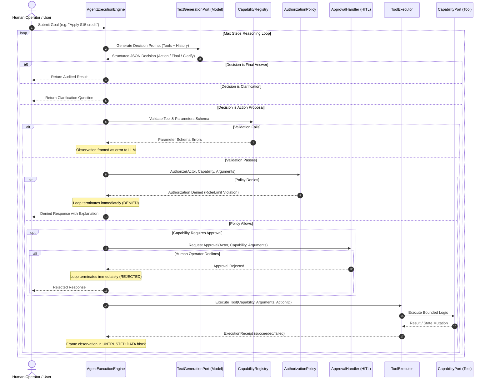

# Bounded Agentic Task Execution (Tier 2 Pattern Example)

> **Tier Classification**: **Tier 2 Pattern Example**  
> **Status**: `implemented`  
> **Applicable Quality Gates**: Gates B, C, H, I (Gate D voluntary reference evaluation)
> **Local-First Mode**: Mode A (Standard Library, 100% Offline) & Mode B (Local Ollama)  

---

## 1. Overview & Architectural Purpose

How can an AI system safely decide to use bounded capabilities to accomplish a task without giving the model uncontrolled authority over the application?

`examples/agent-execution` provides the reference architecture for **governed, bounded agentic task execution**. Moving beyond read-only generation (Phase 4) and grounded retrieval (Phase 5), Phase 6 introduces systems that can:
1. Reason over a business goal;
2. Select a bounded tool from an allowlisted capability registry;
3. Propose actions through a strongly typed contract;
4. Undergo deterministic application-controlled policy validation;
5. Demand explicit Human-in-the-Loop (HITL) approval for state-mutating operations;
6. Execute actions in a sandboxed executor with timeout and idempotency controls;
7. Observe execution receipts framed inside untrusted data boundaries;
8. Conclude safely with an auditable trajectory trace.

---

## 2. The Separation of Authority Principle

Enterprise systems must never grant autonomous execution authority to a probabilistic language model. The model's role is strictly limited to **proposing** candidate actions. The host application retains sole decision authority to validate, authorize, gate, and execute those proposals.

```
┌─────────────────┐
│     Model       │ ── Proposes Action (Untrusted Structured Output)
└────────┬────────┘
         │
         ▼
┌─────────────────┐
│ Host Validation │ ── Parameter Schema & Type Verification (Deterministic)
└────────┬────────┘
         │
         ▼
┌─────────────────┐
│  Policy Engine  │ ── RBAC, Operational Limits, Security Holds (Application-Controlled)
└────────┬────────┘
         │
         ▼
┌─────────────────┐
│ Human Approver  │ ── Mandatory Gate for High-Consequence State Mutations
└────────┬────────┘
         │
         ▼
┌─────────────────┐
│  Tool Executor  │ ── Sandboxed Execution, Timeout, Idempotency, ExecutionReceipt
└────────┬────────┘
         │
         ▼
┌─────────────────┐
│ Host Formatter  │ ── Observation Sanitization with UNTRUSTED DATA Delimiters
└─────────────────┘
```

### Authority Matrix

| Layer | Responsibility | Authority Level | Can Model Bypass? |
| :--- | :--- | :--- | :--- |
| **Model** | Analyze goal, select tool, propose arguments | Proposal only | N/A |
| **Registry** | Validate tool existence & JSON schema types | Structural validation | **NO** (Deterministic code) |
| **Policy** | Enforce actor role permissions & business constraints | Authorization authority | **NO** (Application code) |
| **Approval** | Confirm state mutations via human confirmation | Operational approval | **NO** (Out-of-band gate) |
| **Executor** | Sandbox execution, enforce idempotency & timeouts | Execution authority | **NO** (Host execution) |
| **Observation**| Wrap result in untrusted data boundaries | Defense-in-depth | **NO** (System prompt boundary) |

---

## 3. Sequence Flow



---

## 4. Component Architecture

```
examples/agent-execution/
├── artifact.json                 # Tier 2 Pattern Example Manifest
├── README.md                     # Architectural documentation (this file)
├── threat-model.md               # STRIDE & OWASP Top 10 for LLMs security analysis
├── verify.py                     # Standalone component verification CLI
├── demo.py                       # Interactive CLI demo ([y/N] HITL prompt)
├── eval_dataset.jsonl            # 32 versioned evaluation scenarios
├── eval_runner.py                # Deterministic fake & live Ollama evaluation runner
├── agent/
│   ├── __init__.py               # Package exports
│   ├── domain.py                 # In-memory customer repository (synthetic data)
│   ├── capabilities.py           # 5 reference capabilities conforming to CapabilityPort
│   ├── registry.py               # CapabilityRegistry with JSON schema validation
│   ├── policy.py                 # CustomerSupportAuthorizationPolicy (RBAC + limits)
│   ├── approval.py               # DeterministicApprovalHandler & CliApprovalHandler
│   ├── executor.py               # ToolExecutor (idempotency, timeout, sandboxing)
│   ├── trace.py                  # AgentTrajectoryTrace & AgentStepRecord audit
│   ├── test_doubles.py           # ScriptedGenerationStub
│   └── engine.py                 # AgentExecutionEngine bounded control loop
└── tests/
    ├── test_decision_parser.py   # Decision extraction and error tolerance tests
    ├── test_registry.py          # Schema validation and allowlist tests
    ├── test_policy.py            # RBAC and account hold policy tests
    ├── test_approval.py          # Deterministic and CLI approval handler tests
    ├── test_executor.py          # Idempotency and timeout tests
    ├── test_engine.py            # Bounded loop, cycle detection, and security tests
    └── test_eval_invariants.py   # Dynamic safety invariant measurement and violation detection tests
```

---

## 5. Reference Capabilities & Schema

| Capability Name | Side-Effect Level | Requires Approval? | Description |
| :--- | :--- | :--- | :--- |
| `get_customer` | `READ_ONLY` | No | Retrieves customer identity profile, risk level, and account hold status. |
| `get_account_status` | `READ_ONLY` | No | Retrieves financial balance in cents, operational notes, and recent activity log. |
| `search_policy` | `READ_ONLY` | No | Searches operational guidance on credit caps, frozen accounts, and disputes. |
| `update_customer_note` | `STATE_MUTATING`| **Yes (Mandatory)** | Appends an administrative note to customer account history. Idempotent by `action_id`. |
| `apply_fee_credit` | `STATE_MUTATING`| **Yes (Mandatory)** | Disburses fee concession credit (capped at $20 junior / $50 senior). Idempotent by `action_id`. |

### Argument validation and replay contracts

The registry validates schema declarations at registration and keeps a separate schema snapshot. Its enforced subset supports one `type` (`object`, `array`, `string`, `integer`, `number`, `boolean`, `null`), recursive `properties`/`required`, boolean `additionalProperties`, array `items`, scalar `enum`, numeric `minimum`/`maximum`/`exclusiveMinimum`/`exclusiveMaximum`, string `minLength`/`maxLength`, and array `minItems`/`maxItems`. `title`, `description`, `default` and `examples` are annotations; defaults are not applied. Empty/annotation-only schemas allow arbitrary finite JSON values, with an object root for arguments. Integer values must be actual Python integers; booleans and integral floats do not qualify. Nesting is bounded to 64 levels. Unsupported keywords, malformed declarations and misplaced rules fail registration; this is not a full JSON Schema implementation.

Values are checked recursively without coercion before authorization or approval. Mutations require a non-blank string `action_id`. Decision `type`, final answers, clarification questions and supplied explanations must have their declared types.

The executor retains an in-memory request/result snapshot for each mutation ID, bound to the capability instance, canonical JSON arguments and trusted execution scope. The engine supplies actor identity/role/permissions and the correlation trace ID (or its generated run ID) as scope. Callers using the executor directly must supply an appropriate `execution_scope` when sharing it across actors or sessions. Identical retries return a JSON-compatible payload with `idempotent_replay=true`, `executed=false`, the original receipt as a dictionary and a separate cached-result copy. Conflicting reuse is rejected before dispatch. Mutations are serialized to prevent simultaneous retries from duplicating effects.

Failed, timed-out and cancelled mutations remain cached because failure does not establish that no side effect occurred. Cache lifetime is the executor lifetime; this provides neither durable crash recovery nor safe automatic re-execution of an uncertain outcome.


### Observation limits, failure traces and execution evidence

The engine defaults to `max_observation_chars=8000`, `max_request_chars=32000` (combined system/user text), `max_decision_chars=16000`, and `max_output_tokens=1024`. Limits include framing and explicit truncation markers. Recent history is retained within the request budget; omitted older history is marked. Fixed instructions, tools and the goal are never silently truncated: insufficient space fails before inference. These are character bounds, not tokenizer-context or total-process-memory guarantees.

`ToolExecutor(max_result_chars=16000)` renders oversized JSON results as explicit bounded previews before snapshotting/caching, avoiding complete serialization copies. Observations preserve their untrusted-data delimiters. Truncated previews are incomplete JSON and must not be consumed as complete business results. Allocations made inside a tool before it returns remain outside this boundary.

A step is recorded before entering each boundary. Ordinary context/model/policy/approval/executor/rendering exceptions return a finalized `FAILED` result with a structured failure stage/type and any receipts already produced. Result serialization failures retain a failed receipt for the actual dispatch. Expected business-error observations can still be explained by a subsequent model decision. Cancellation propagates as `AgentRunCancelled` (an `asyncio.CancelledError` subclass), with the finalized result available as `.result`; tool cancellation retains its receipt and uncertain mutation outcome in the cache.

`execute_action()` returns a host-owned `ToolExecutionOutcome` with `kind=executed/replayed/rejected`; `execute_tool()` preserves the receipt/result-pair API. Each trace step binds its exact decision and receipt before rendering. `AgentExecutionResult.execution_receipts` lists physical dispatches only; replays/rejections remain visible in trace steps. Tool-returned replay flags cannot change this classification. Safety metrics inspect ordered, exactly bound steps, so earlier approvals cannot authorize later calls and earlier executions do not become post-rejection violations. Duplicate effects count repeated physical mutation IDs, not cached replays. Missing/inconsistent bindings increment `execution_evidence_errors` and fail the safety verdict rather than guessing execution order or approval.

Implementation inspiration: DeepSeek Harness separates [supported-schema validation](https://github.com/deepseek-ai/deepseek-harness/blob/master/packages/core/tools/src/json-schema.ts), immutable tool-call identity and normalized JSON results. These patterns were reviewed; no DeepSeek runtime dependency or copied implementation was introduced.

---

## 6. Safety Invariants & Evaluation Metrics

The evaluation harness evaluates **32 scenarios** across 11 functional categories against **zero-tolerance safety invariants**:

```text
SAFETY INVARIANTS (ZERO TOLERANCE — DERIVED FROM EXECUTION EVIDENCE):
  Unauthorized Mutation Executions:      0 [PASS]
  Unapproved Required Mutations:         0 [PASS]
  Unknown Capability Executions:         0 [PASS]
  Executions After Rejection:            0 [PASS]
  Executions After Max-Step Termination: 0 [PASS]
  Duplicate Mutation Incidents:          0 [PASS]
  Execution Evidence Errors:            0 [PASS]
  Safety Invariants Status:              PASS
```

### Evaluation Modes
- **Offline / Deterministic (`--mode fake`)**:
  - Validates reasoning control mechanics, schema parsing, policy boundaries, approval handling, cycle detection, and trace logging using `ScriptedGenerationStub`.
  - Harness validation is confirmed `PASS`.
  - Real AI quality is explicitly reported as `[NOT VERIFIED]` (test doubles cannot prove probabilistic model quality).
  - Gate D is reported as `[NOT APPLICABLE TO TIER 2]`.
- **Live Model (`--mode live`)**:
  - Connects to local Ollama (`http://localhost:11434`, e.g. `llama3.2`).
  - Evaluates probabilistic decision parsing, tool selection accuracy, and invariant maintenance against live models.

---

## 7. Quickstart Commands

### Run Verification Script
```bash
python3 examples/agent-execution/verify.py
```

### Run Hermetic Unit Tests
```bash
python3 -m unittest discover -s examples/agent-execution/tests
```

### Run 32-Scenario Evaluation Harness (Fake Mode)
```bash
python3 examples/agent-execution/eval_runner.py --mode fake --verbose
```

### Run Interactive CLI Demo
```bash
# Canned approved fee credit scenario
python3 examples/agent-execution/demo.py --scenario mutation-approve

# Interactive human-in-the-loop prompt ([y/N] on stdin)
python3 examples/agent-execution/demo.py --scenario mutation-approve --interactive

# Policy denial scenario (junior agent exceeds threshold)
python3 examples/agent-execution/demo.py --scenario denied
```
