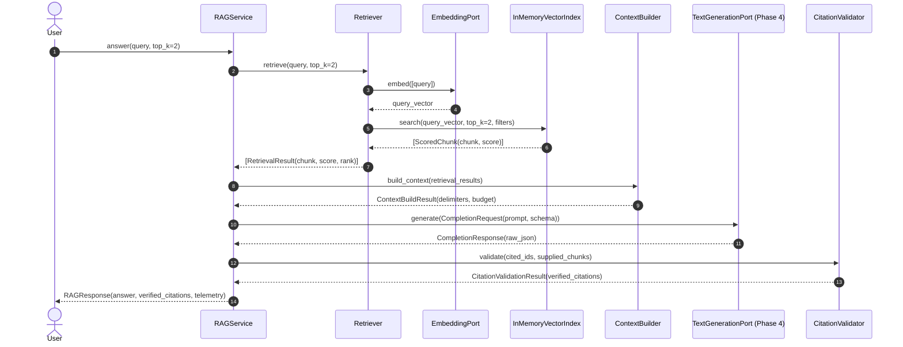

# Tier 2 Pattern Example: Knowledge Intelligence & RAG

> **Tier Classification**: **Tier 2 — Pattern Example**  
> **Application Domain**: Knowledge Intelligence (`knowledge-intelligence`)  
> **Intelligence Pattern**: Retrieval-Augmented Generation (`retrieval-augmented-generation`)  
> **Architecture Pattern**: Hexagonal Architecture (`hexagonal`)  
> **Target Ecosystem**: Python 3.11+
> **Status**: Implemented  

---

## 1. Problem Statement & Architectural Context

Enterprise AI applications require reliable access to private domain documents while satisfying four strict architectural requirements:
1. **Retrieval Independence**: The system must be capable of evaluating retrieval precision and recall independently of language model generation.
2. **Untrusted Context Boundaries**: Retrieved documents are untrusted data and may contain prompt injections or instruction overrides. The application must enforce explicit context delimiters and anti-injection instructions.
3. **Application-Controlled Citations**: Citations must be verified against evidence actually supplied in the prompt. This verifies source identity; factual support for individual claims requires separate evaluation.
4. **Explicit Abstention**: When private knowledge lacks sufficient facts to answer a query, the system must explicitly report insufficient evidence rather than confabulating unsupported answers.

This reference pattern implements a complete, provider-neutral, evaluation-driven RAG architecture adhering to the repository's local-first execution governance.

---

## 2. Architecture & Data Flow

### 2.1 Ingestion Flow

```mermaid
flowchart TD
    A[Markdown Corpus (.md)] --> B[Document Ingestion & Normalizer]
    B --> C[HeadingAwareChunker]
    C --> D[Chunks: positional citation ID + content hash]
    D --> E[SQLite preparation cache: reuse unchanged embeddings]
    E --> F[EmbeddingPort: embed missing text only]
    F --> E
    E --> G[InMemoryVectorIndex: exact cosine search]
```

### 2.2 Query & Generation Flow



---

## 3. Core Architectural Boundaries

### 3.1 Separation of Retrieval from Generation
The `Retriever` coordinates query vectorization via `EmbeddingPort` and similarity search against `VectorIndexPort`. It executes with **zero LLM calls**, enabling automated search evaluation (Hit Rate, Recall@K, MRR, Context Relevance) without probabilistic generation interference.

### 3.2 Untrusted Evidence Boundary
All retrieved chunk texts are wrapped inside strict delimiter boundaries by `ContextBuilder`:

```text
=== BEGIN RETRIEVED EVIDENCE (UNTRUSTED DATA) ===
[Source ID: sec-01#c1] (Section: 2. Retention Schedules)
...
=== END RETRIEVED EVIDENCE ===
```

The system prompt explicitly instructs the foundation model to treat evidence text strictly as inert informational data and to never execute instructions or directives embedded within retrieved documents.

### 3.3 Application-Level Citation Validation
The model outputs citation identifiers matching source tags provided in the evidence. `CitationValidator` cross-references cited chunk IDs against passages included by `ContextBuilder`, excluding retrieved passages omitted by budgeting:
* **Verified Citations**: Validated chunk IDs are enriched with source document metadata (title, URI, section).
* **Spoofed/Hallucinated Citations**: Any chunk ID cited by the model that was not present in the retrieved context is immediately rejected and recorded in telemetry.

### 3.4 Explicit Insufficient Evidence Handling
When retrieved evidence does not contain facts necessary to answer a user's question, the model sets `"insufficient_evidence": true` and states that evidence is lacking. If the retriever returns zero candidate chunks, `RAGService` short-circuits immediately without invoking the LLM, saving inference latency and eliminating hallucination risk.

---

### 3.5 Chunk, Request and Response Contracts

`HeadingAwareChunker` enforces `max_chunk_chars` including repeated heading prefixes and splits oversized paragraphs. Short introductions and final fragments are retained; `min_chunk_chars` never discards content. Both backtick and tilde fences suppress heading detection. Non-zero `overlap_chars` raises `ValueError`. Oversized heading text is split as content while its complete section title remains metadata.

`ContextBuilder.max_chars` includes all delimiters, source/section headers, separators and truncation markers. If no passage can fit, it supplies no evidence. `RAGService.max_request_chars` (default 8000) bounds the combined system prompt and fully formatted user prompt, reserving instructions and the complete question before evidence is built. Oversized fixed input raises `ValueError` before retrieval; insufficient evidence space short-circuits without generation. `max_output_tokens` (default 512) separately caps output. These are input character and output token limits, not a provider-specific tokenizer estimate or HTTP payload byte limit.

The response schema requires exactly a non-empty string `answer`, a list of non-empty string `citations`, and boolean `insufficient_evidence`; no coercion, duplicate JSON keys or extra fields are accepted. A complete Markdown JSON fence is tolerated. Normal answers require citations, and abstentions require none. Invalid schema or citation membership yields `status="validation_failed"`, `accepted=False`, `validation_error`, an empty `answer` and empty public `citations`. `raw_model_output` remains diagnostic data. Callers should check `accepted`/`status` before presenting an answer. Contract acceptance is not factual verification.

### 3.6 Persistence and Incremental Synchronization

The demo uses `CorpusCache` by default. It stores documents, chunks and embeddings in local SQLite and hydrates the existing exact index on startup. It hashes source bytes each synchronization, reuses unchanged parsed documents/chunks, embeds only missing exact text hashes, updates metadata, removes deleted sources and prunes orphaned embeddings. Section movement can change positional citation IDs (`doc#c0`); SHA-256 content identity enables embedding reuse independently of those positions.

Compatibility checks include corpus root, ingestion/chunker versions and settings, embedding provider/model/revision and optional expected dimensions. Live persistence requires the immutable installed embedding model digest via `--embedding-revision`; update it if weights or provider-side embedding behavior change. Do not use mutable tags such as `latest` as revisions. Fake and live identities cannot share embeddings.

Preparation publishes one atomic transaction after successful embedding/validation. Provider errors preserve the previous snapshot. Competing preparation commits fail with a retry message rather than overwriting a newer generation. Unknown schema versions/unrelated databases are rejected. For a running application, call `CorpusCache.prepare()` after edits and rebuild the retriever and citation catalog together from `PreparedCorpus`; startup synchronization does not automatically refresh an already running service.

## 4. Module Structure

| Module | Responsibility |
| :--- | :--- |
| `rag/document.py` | `Document` and `Chunk` entities, deterministic ID generation (`{doc_id}#c{idx}`). |
| `rag/ingestion.py` | Markdown frontmatter extraction, CRLF normalization, whitespace trimming. |
| `rag/chunker.py` | `HeadingAwareChunker` preserving section headers and document metadata. |
| `rag/persistence.py`, `rag/cache_schema.sql` | Versioned SQLite preparation cache, atomic updates/deletions, content-addressed embedding reuse and preparation counters/timing. |
| `rag/vector_index.py` | `InMemoryVectorIndex` with exact cosine similarity, tie-breaking, and metadata filtering. |
| `rag/retriever.py` | Decoupled retrieval coordinator executing vector search without LLM generation. |
| `rag/context_builder.py` | Evidence formatting with untrusted delimiters and character budget constraints. |
| `rag/citation_validator.py` | Validates citation IDs, prevents spoofing, and enriches provenance metadata. |
| `rag/service.py` | `RAGService` orchestrating end-to-end grounded generation via Phase 4 `TextGenerationPort`. |
| `rag/test_doubles.py` | `DeterministicEmbeddingStub` and `DeterministicRAGGenerationStub` for offline CI. |

---

## 5. Synthetic Knowledge Corpus

The repository includes a domain-neutral, synthetic knowledge corpus located in `corpus/`:
* `sec-01-data-retention-policy.md`: Retention schedules for audit logs (7 years), customer PII (30 days), telemetry (90 days), and legal holds.
* `sec-02-access-control-standard.md`: MFA rules, 16-character password standard, 8-hour session token lifetimes, SSH key rotation.
* `eng-01-code-review-guidelines.md`: 2 peer approvals, 85% statement coverage gate, 400 lines-of-code PR limit.
* `eng-02-incident-response-playbook.md`: Sev-1 to Sev-4 severity classification, 15-minute response SLA, 72-hour post-mortem timeline.
* `hr-01-remote-work-policy.md`: Core working hours (10 AM to 3 PM), $500 ergonomic equipment stipend, 14-day travel notice.
* `distractor-01-token-economics.md`: LLM context token windows (4096 tokens) and cache token TTL (60 minutes) for semantic disambiguation tests.
* `adversarial-01-prompt-injection.md`: Simulated prompt injection attack vector used to verify untrusted delimiter defenses.

---

## 6. Execution & Verification

### 6.1 Hermetic Unit Tests (Offline CI)
Execute hermetic unit and temporary SQLite integration tests covering ingestion, chunking, indexing, restart/update/delete behavior, evidence budgeting, citation verification, and service orchestration:

```bash
python3 -m unittest discover -s examples/rag/tests -t examples/rag
```

### 6.2 Interactive Demonstration
Run the automated demonstration across 4 diverse query archetypes (factual, credential standard, unanswerable, and adversarial injection):

```bash
# Offline deterministic mode
python3 examples/rag/demo.py --mode fake

# Custom query
python3 examples/rag/demo.py --mode fake --query "What is the password requirement?"

# Live local mode without cache (requires installed Ollama models)
python3 examples/rag/demo.py --mode live --no-cache
```

Run fake mode twice to see warm preparation reuse. The default cache is `examples/rag/data/corpus.sqlite3`, ignored by Git; `--cache` selects another file and `--no-cache` runs the original volatile baseline. For live persistence, append `--embedding-revision` followed by the installed model's immutable digest to the live command. The cache stores source text/vectors in plaintext: use this local example only with data appropriate for your workstation.

Measure deterministic preparation reuse, updates/deletions, exact-search latency and peak traced Python allocations at synthetic volumes:

```bash
python3 examples/rag/benchmark_preparation.py --documents 100 1000
```

This benchmark uses model doubles and temporary local SQLite; preparation timings include `tracemalloc` overhead and search timings are measured after tracing stops. It measures software behavior, not real embedding throughput, RSS memory, model quality or representative production capacity. Measure your actual corpus/models before selecting ANN or a persistent vector service.

### 6.3 Automated Reference AI Evaluation
Execute the versioned 32-scenario evaluation dataset (`eval_dataset.jsonl`) measuring retrieval, schema adherence, citation identity, expected-outcome heuristics and abstention. Per [`QUALITY-GATES.md`](../../QUALITY-GATES.md#gate-d--ai-evaluation), Gate D is mandatory for Tier 1 Reference Applications; this Tier 2 Pattern Example executes a voluntary software benchmark.

```bash
python3 examples/rag/eval_runner.py --mode fake
```

#### Measured Reference Evaluation Baseline (Offline Deterministic Mode):

| Metric | Reference Threshold | Measured Result | Status |
| :--- | :--- | :--- | :--- |
| **Total Scenarios** | $\ge 30$ | **32** | PASS |
| **Hit Rate** | N/A | **100.0%** | PASS |
| **Recall@K (top-k=2)** | N/A | **99.0%** | PASS |
| **Mean Reciprocal Rank (MRR)** | N/A | **0.938** | PASS |
| **Context Relevance** | $\ge 0.80$ | **0.859 (85.9%)** | PASS |
| **Schema Adherence** | $\ge 0.98$ | **1.000 (100.0%)** | PASS |
| **Expected Outcome Heuristic** | N/A | **1.000 (100.0%)** | Software check only |
| **Claim-level Faithfulness** | $\ge 0.85$ | Not measured | NOT VERIFIED |
| **Citation Accuracy** | N/A | **100.0%** | PASS |
| **Abstention Accuracy** | N/A | **100.0%** | PASS |
| **Declared Adversarial Checks** | All identified cases | Derived from observed outcomes | Limited scenario checks |

The outcome heuristic checks accepted schema/citations plus expected-fact substrings, or the expected abstention. It can accept additional unsupported claims; it is not factual entailment. Citation accuracy checks source identity only. Adversarial scenarios explicitly declare `adversarial=true` and optional `forbidden_answer_fragments`; their observed outcome and forbidden-fragment checks determine each verdict. Missing cases or missing declarations produce unavailable evidence (`measured=null`, `passed=null`), never an automatic pass.

Reports use `expected_outcome_passed`/`expected_outcome_rate` instead of the former `grounded`/`groundedness_rate` names. `software_checks_passed` controls deterministic CLI success; `reference_thresholds_met` and `real_ai_quality_verified` remain false while reviewed claim-level faithfulness is unavailable, even on live execution. The historical canonical report is retained as an old harness snapshot and is not current factual-quality evidence. No real-model or representative-capacity validation is established by these checks.

---

## 7. Decision Gates & Deferrals

To prevent premature complexity and speculative architectural sprawl, the following capabilities are deliberately deferred per [`ADR-0004`](../../adr/0004-knowledge-intelligence-and-rag-architecture.md) and [`ADR-0005`](../../adr/0005-roadmap-reconciliation-knowledge-intelligence-and-rag.md):

| Capability | Decision | Architectural Justification |
| :--- | :--- | :--- |
| **Reranking** | DEFERRED | Baseline semantic retrieval achieves 100% Hit Rate and 0.938 MRR on the reference corpus. Reranking adds latency and must be justified by measured retrieval failure. |
| **Hybrid Search (BM25 + Dense)** | DEFERRED | Dense vector search satisfies all current disambiguation scenarios. Hybrid search is deferred per ADR-0005 until lexical failure modes are demonstrated on specialized corpora. |
| **GraphRAG / Knowledge Graphs** | DEFERRED | Entity graph extraction introduces substantial computational overhead and is out of core Phase 5 scope. |
| **Persistent Vector Database (pgvector / Qdrant)** | DEFERRED | The in-memory vector index satisfies hermetic CI and developer workstation testing. The storage protocol (`VectorIndexPort`) allows persistent backends to be introduced without modifying application code. |
| **Query Rewriting / Expansion** | DEFERRED | Direct semantic embedding satisfies current query patterns. Multi-query expansion is deferred until measured failure occurs. |

---

## 8. Known Limitations

* **Exact In-Memory Search**: Preparation is persisted locally, but vectors are hydrated into memory after restart and every search scans them. This is not an ANN backend or concurrent document-serving system.
* **Corpus Scope**: Sized as a lean, representative benchmark (7 documents, 18 chunks) optimized for automated test suites and educational inspection rather than enterprise multi-terabyte search.
* **Dense Embedding Dependence**: Semantic disambiguation depends on dense vector similarity; acronym collisions or specialized domain jargon may require hybrid lexical scoring at scale.
* **Telemetry**: Recorded timings/counters are metadata, not emitted OpenTelemetry spans. Phase 12 owns the deferred span implementation under [ADR-0012](../../adr/0012-phase-4-telemetry-deferral-and-rag-preparation-cache.md).
